# RustyCorn

RustyCorn logs and plots runs of an **ÄKTAprime** or **ÄKTAprime plus**
chromatography system connected to a PC over RS-232. It starts in about a
second, keeps the window responsive during a run and ships as one executable
with nothing else to install.

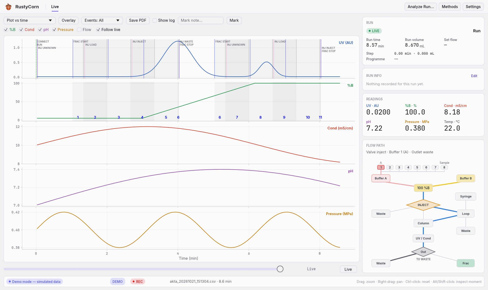

## Origins

Initially this software was based on the julia implementation of AktaPrime by the Waudby Lab ([AktaPrime.jl](https://github.com/waudbylab/AktaPrime.jl)), but was reimplemented in Rust for a smoother experience and more functionality.
RustyCorn's CSV logs and `PrimeMeth_NNN.txt` method files are interchangeable with AktaPrime.jl.

> **Disclaimer.** RustyCorn is an **independent, unofficial** project. It is
> **not affiliated with, authorised, endorsed, or supported by Cytiva**
> (formerly GE Healthcare) or any related entity. "ÄKTA", "ÄKTAprime",
> "PrimeView" and "UNICORN" are trademarks of their respective owners and are
> used here only to identify the hardware and software with which this project
> interoperates.

## Contents

- [Features](#features)
- [Screenshots](#screenshots)
- [Download](#download)
- [Building from source](#building-from-source)
- [Running](#running)
- [Settings](#settings)
- [Data and methods folders](#data-and-methods-folders)
- [Run information](#run-information)
- [Storing methods on the PC](#storing-methods-on-the-pc)
  - [The example method](#the-example-method)
- [Analysing a run and exporting a PDF](#analysing-a-run-and-exporting-a-pdf)
- [Working with the plots](#working-with-the-plots)
- [Volume unit: 1 or 10 µL](#volume-unit-1-or-10-µl)
- [Troubleshooting](#troubleshooting)
- [Development](#development)
- [Licence](#licence)

## Features

- **Live recording** of UV, conductivity, pH, %B, pressure, flow, run state,
  valve positions, fractions and the instrument's log messages; one CSV file
  per run, written row by row, so a crash loses nothing.
- **Live plots** in stacked panels or one overlay plot, against time, volume
  or column volumes, with faint grid lines, zoom, pan, an inspector for any
  moment and marks with notes. The **Events** menu chooses which event lines
  and labels are drawn (all, all but the method steps, none). The run log can
  be filtered by text.
- **Flow-path schematic** and reading cards showing the instrument's state,
  live or at the inspected moment.
- **PC method store:** the ÄKTAprime can save methods to the PC and run them
  from it (`PrimeMeth_NNN.txt`), as with PrimeView. The methods folder can be
  separate from the data folder, e.g. shared on a network drive, and a new
  one starts with an example method.
- **Method editor** to name, view, write and check methods on the PC, also
  without an instrument (`rustycorn --methods`). Values the instrument would
  reject are marked in red, and such a method is not saved.
- **Run information:** column, buffers and notes kept with each PC method and
  recorded automatically when the instrument runs it; every field asked for
  at run start and editable while the run goes on, and later.
- **Analyze Run:** open any saved log in its own tab, inspect it, add run
  information and export the plot as a vector PDF.
- **Light and dark theme.** Settings are saved at once; a settings file that
  cannot be read is kept as a backup copy and reported, not overwritten.
- **Demo mode** with simulated data, for trying it out without an instrument.
- Reconnects by itself when the cable is pulled or the instrument restarts.

## Screenshots

Click an image to see it full size. All were taken in demo mode or with
example data.

| | |
|---|---|
| [](assets/screenshot.png)<br>[Live run](#running) with fractions, readings and flow path | [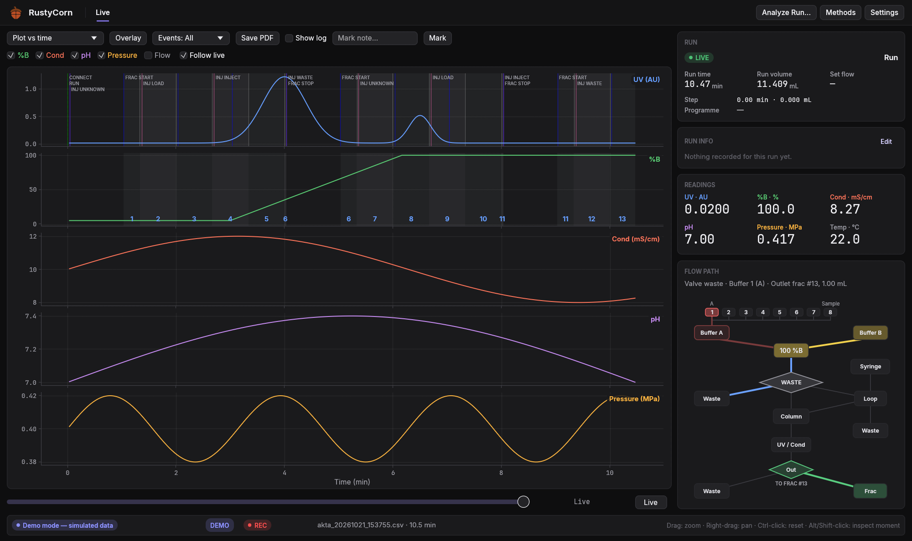](assets/screenshots/dark-mode.png)<br>[Dark mode](#settings) |
| [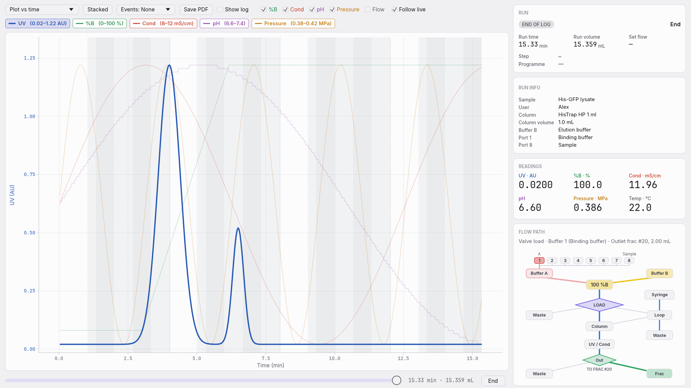](assets/screenshots/overlay.png)<br>[Overlay plot](#working-with-the-plots), UV highlighted | [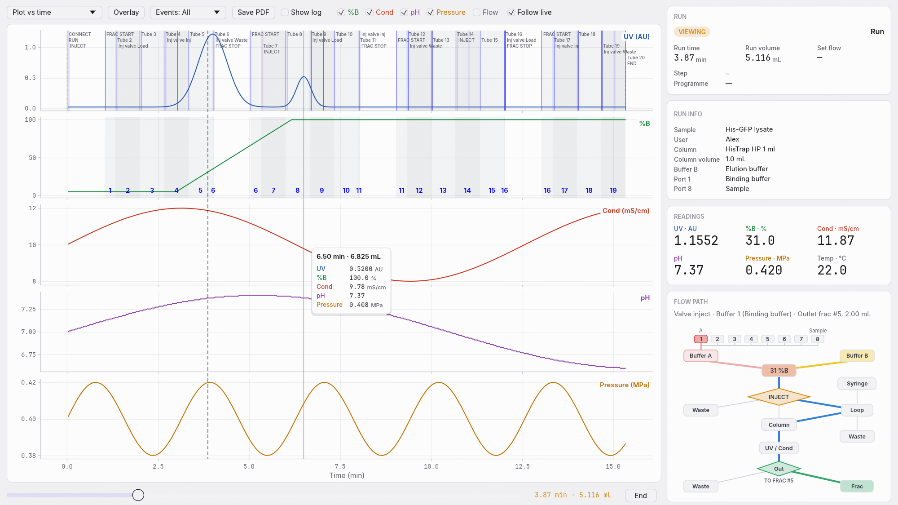](assets/screenshots/inspector.png)<br>[Inspecting a moment](#working-with-the-plots) |
| [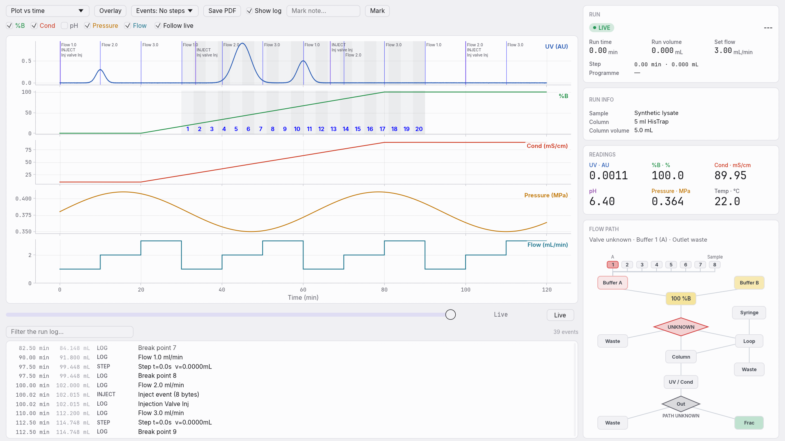](assets/screenshots/run-log.png)<br>[Run log](#working-with-the-plots), Events: No steps | [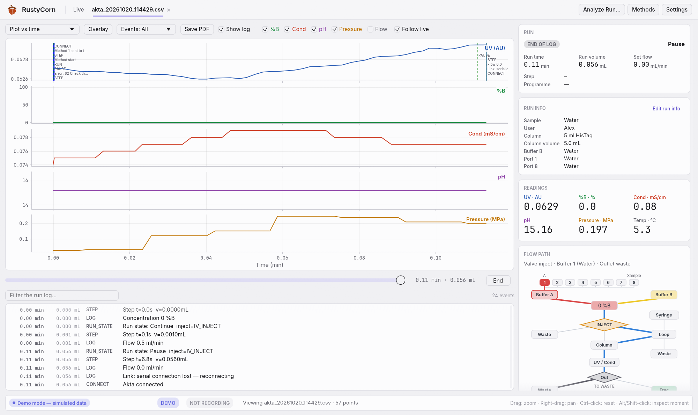](assets/screenshots/analyze-run.png)<br>[A saved log](#analysing-a-run-and-exporting-a-pdf) in its own tab |
| [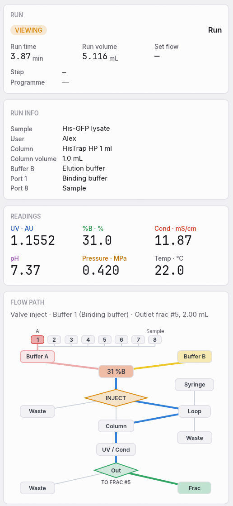](assets/screenshots/flow-path.png)<br>[Side panel](#analysing-a-run-and-exporting-a-pdf) with the flow path | [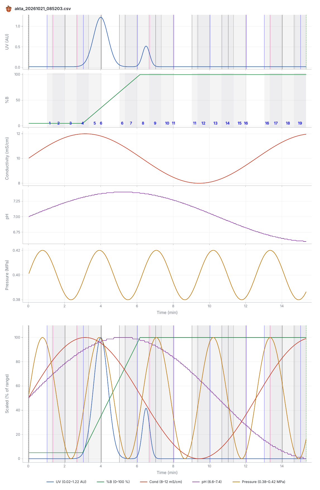](assets/screenshots/pdf-export.png)<br>[PDF export](#analysing-a-run-and-exporting-a-pdf) |
| [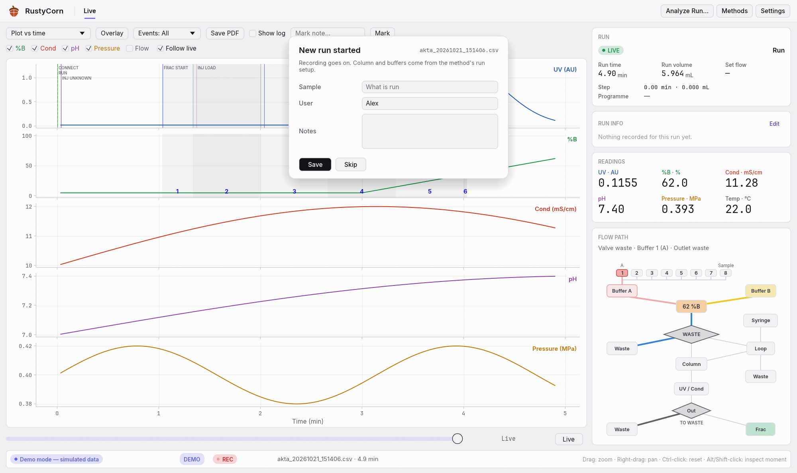](assets/screenshots/new-run.png)<br>[Run information](#run-information) at a run start | [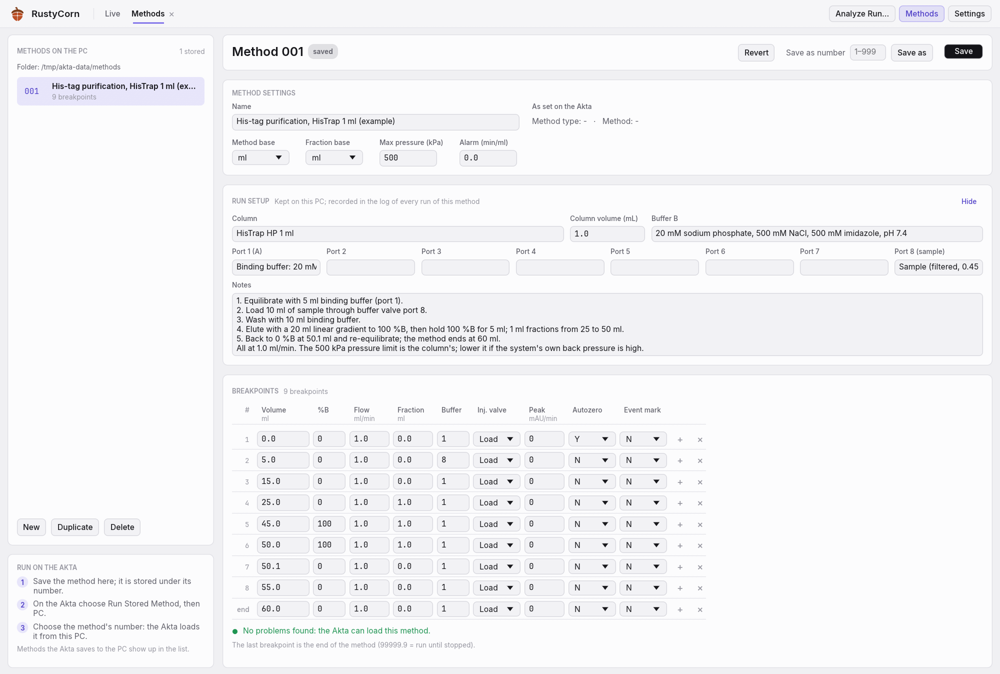](assets/screenshots/method-editor.png)<br>[Method editor](#storing-methods-on-the-pc) with the example method |
| [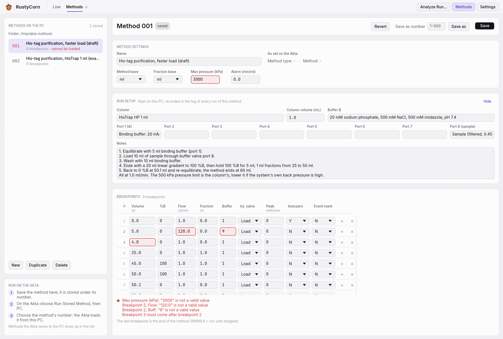](assets/screenshots/method-validation.png)<br>[Method editor](#storing-methods-on-the-pc): invalid values | [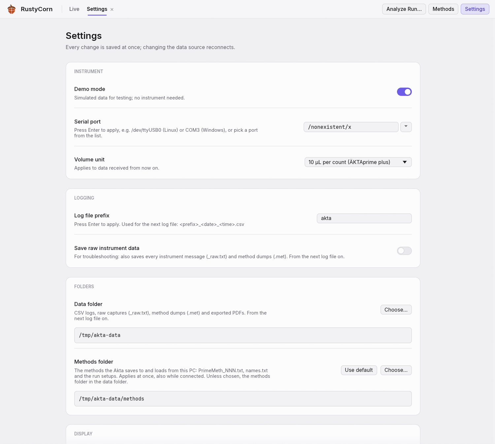](assets/screenshots/settings.png)<br>[Settings](#settings) with the folders |

## Download

**Windows (10 or 11, 64-bit):** download `RustyCorn-<version>-windows.zip`
from the [Releases page](https://github.com/CalvinKlein96/RustyCorn/releases),
unzip it anywhere and double-click `RustyCorn.exe`. Nothing is installed, no
administrator rights or extra runtimes are needed. The zip contains a short
`README.txt` with the first steps. Windows SmartScreen may warn because the
program is not signed: **More info → Run anyway**.

**Linux:** build from source (below).

The cable: use a USB-to-serial adaptor with an **FTDI** chip (FT232RL), not a
Prolific PL2303 one, which is unreliable with this instrument.

## Building from source

Install Rust (1.95 or newer) from <https://rustup.rs>.

**Linux.** No extra system libraries are needed (serial ports are listed
from sysfs, so the build does not need the udev headers):

```bash
git clone https://github.com/CalvinKlein96/RustyCorn.git
cd RustyCorn
cargo build --release          # → target/release/rustycorn
./RustyCorn.sh                 # builds if needed, then starts; takes the same arguments
```

The binary needs only the C library and a graphics driver (Vulkan or OpenGL,
as in any desktop installation). To add it to your desktop menu (a
**RustyCorn** entry with icon, plus a **Method editor** action):

```bash
packaging/linux/install.sh               # → ~/.local/bin, ~/.local/share/{applications,icons}
packaging/linux/install.sh --uninstall   # removes those files; settings and data stay
```

The menu entry starts without a terminal, so the log prefix is not asked
(the last one is used) and you should set a data folder in Settings.

**Windows, cross-built on Linux.** Needs the mingw-w64 toolchain (for the
linker and `windres`, which embeds the icon):

```bash
rustup target add x86_64-pc-windows-gnu
sudo apt install mingw-w64 zip
packaging/windows/make_bundle.sh         # → dist/RustyCorn-<version>-windows.zip
```

The script builds `rustycorn.exe` (in `target-win/` unless `CARGO_TARGET_DIR`
is set), checks that it needs no DLLs beyond those of Windows itself, and packs
it as `RustyCorn.exe` with `README.txt` and the licences. A plain
`cargo build --release --target x86_64-pc-windows-gnu -p rustycorn` gives the
bare executable.

**Windows, native.** With Rust's default MSVC toolchain, `cargo build
--release` in this folder gives `target\release\rustycorn.exe`.

## Running

| Command | What it does |
|---|---|
| `rustycorn` | Main window. The data source (instrument or demo) and serial port come from Settings. |
| `rustycorn /dev/ttyUSB0` or `rustycorn COM3` | Use this serial port; it is saved for next time. |
| `rustycorn run.csv` | Open a saved log in a read-only viewer, without connecting to the instrument. |
| `rustycorn --methods` | Only the method editor: no serial connection, no log file. For preparing methods away from the instrument. |
| `rustycorn --gpu gl` | Draw the window with this graphics backend (`auto`, `gl`, `dx12`, `vulkan`, `metal`); it is saved for next time. Combines with the others, e.g. `rustycorn --gpu gl COM3`. |
| `rustycorn --help` | Print the usage. |

From the source folder, `./RustyCorn.sh` takes the same arguments. On
Windows, use `RustyCorn.exe` in a Command Prompt, or double-click it.

RustyCorn first prints a short summary in the terminal (data folder, methods
folder, serial port) and asks for a **log-file prefix**, a label such as a
sample name or your initials. **Enter** keeps the last one. Started from a
desktop menu entry there is no terminal, and the last prefix is used. The
prefix can also be changed in Settings.

On the very first start RustyCorn uses its defaults: open **Settings** and
choose the serial port, the volume unit of your instrument and a data folder
(or switch on demo mode to look around first).

Then the window waits for the instrument. Run the ÄKTAprime from its own front
panel as usual: RustyCorn watches and records, it does not control the
separation. Every run is written to its own `<date>_<time>_<prefix>.csv`;
logs without any data are deleted. If the cable is pulled or the instrument
stops answering, RustyCorn keeps retrying and reconnects by itself.

To stop, close the window (or press Ctrl-C in the terminal). The log is
closed and RustyCorn prints where the data were saved.

The Windows executable is a console program: a console window shows the
summary, the prefix question and the log messages next to the main window.
Closing that console ends RustyCorn at once; the log file is complete up to
the last row, but the closing summary is not printed.

## Settings

Click **Settings** in the top bar. Every change is saved at once.


*The Settings page (demo mode).*

| Setting | |
|---|---|
| Demo mode | Simulated data, no instrument needed. |
| Serial port | Pick from the list or type, e.g. `/dev/ttyUSB0` or `COM3`, and press Enter. |
| Volume unit | 1 µL per count (ÄKTAprime) or 10 µL per count (ÄKTAprime plus); see [below](#volume-unit-1-or-10-µl). |
| Fraction delay volume | The delay volume between the UV cell and the fraction collector, as set on the instrument (default 580 µL). The ÄKTAprime moves the rack that much after each fraction boundary, so each tube holds what passed the UV cell between two boundaries, as the plot shows. What passed it in the last delay volume before a run ends is still in the tubing when the pump stops: the last fractions are cut there, and a tube that would only start after that point stays empty. |
| Log file prefix | Prefix for the next log file. |
| Data folder | Where the CSV logs, raw captures, method dumps and the PDFs exported from the Live tab go (from the next log on). |
| Methods folder | Where the methods the instrument saves to and loads from the PC are kept (`PrimeMeth_NNN.txt`, `names.txt`, run setups). Unless one is chosen, `methods` in the data folder. Applies at once. |
| Save raw instrument data | For troubleshooting: also save every instrument message and the method dumps. |
| Dark mode | Dark or light colours (PDF exports are always light). |
| Display refresh | How often live plots redraw; data are always recorded in full. |
| Panels shown at start | Which plots are on when the program starts or a run is opened (UV is always shown). |
| Graphics backend | How the window is drawn: Automatic, OpenGL, DirectX 12, Vulkan or Metal (as the system offers). OpenGL is the default on Windows, Automatic elsewhere. Applies at the next start; see [Troubleshooting](#troubleshooting). |


*Dark mode: a demo run with fractions.*

The settings file is

| System | Location |
|---|---|
| Windows | `settings.toml` next to `RustyCorn.exe` |
| Linux | `~/.config/RustyCorn/settings.toml` (or `$XDG_CONFIG_HOME/RustyCorn/`) |
| macOS | `~/Library/Application Support/RustyCorn/settings.toml` |

On Windows the folder of `RustyCorn.exe` holds everything: the settings,
`crash.log` and, until another data folder is chosen, the logs and the
methods folder. Copy or move that folder and everything goes with it; to keep
the settings when updating, copy `settings.toml` into the new folder. On the
first start in a folder, settings of an earlier start from
`%APPDATA%\RustyCorn\settings.toml` are copied in. (If the folder cannot be
written to, e.g. under `C:\Program Files`, `%APPDATA%\RustyCorn` is used.) On
Linux and macOS the same happens when a `settings.toml` lies next to the
program.

Delete the settings file to start over with the defaults. If the file cannot be read
cleanly (edited by hand and broken, or a value out of range), RustyCorn keeps
a copy of it as `settings.toml.broken-<date>-<time>` next to it, uses the
defaults for what it could not read, and says so in the top bar, so nothing
is lost when the settings are saved again. The folder can be changed with the
environment variable `RUSTYCORN_CONFIG_DIR`, for example to try something
without touching the real settings.

## Data and methods folders

- **Data folder** (Settings → Folders → Data folder → Choose…): one CSV log
  per run, `<date>_<time>_<prefix>.csv`, the raw captures and method dumps of
  **Save raw instrument data**, and the PDFs saved with **Save PDF** in the
  Live tab (an opened log's PDFs go next to that log). Until one is
  chosen, the folder of `RustyCorn.exe` is used on Windows, and elsewhere the
  folder RustyCorn was started from. A new data folder is used from the
  next log on.
- **Methods folder** (Settings → Folders → Methods folder → Choose…): the
  methods stored on the PC, `PrimeMeth_001.txt` … `PrimeMeth_999.txt` (the
  files PrimeView uses), their names in `names.txt` and their run setups;
  replaced or deleted methods are moved to its `old/` folder. Until one is
  chosen it is `methods` in the data folder and moves with the data folder;
  **Use default** goes back to that. A new methods folder applies at once,
  also while connected: the method editor shows it and the instrument's next
  save or load uses it, without reconnecting. A methods folder of its own can
  be shared, e.g. on a network drive, while each PC keeps its logs in its own
  data folder.

The CSV logs are plain text: a comment line with the start time, a header,
then one row per data point or event. They open in any spreadsheet program;
the format is described in [ARCHITECTURE.md](ARCHITECTURE.md#file-formats).

## Run information

RustyCorn records run information in two parts.

**The method's run setup.** Column, column volume (mL), buffer B, the
names of buffer-valve ports 1–8 and notes on the method (several lines, e.g.
how to prepare the column) belong to a PC method. Enter them in the method
editor (**Methods** → select a method → **Run setup** card). They are saved
next to the method as `PrimeMeth_NNN_setup.txt` in the methods folder and move
to `old/` with it.

When a run starts, the instrument sends its method to the PC. RustyCorn
compares it with the stored methods by content. If it matches one, that
method's run setup and a line `PC method: NNN – name` are written into the new
log, and the method's notes as `Method notes: …`. The buffer names then appear
in the flow-path card, and the column volume enables **Plot vs column
volumes**. With no match, no setup is recorded.

**At run start and during the run.** When a run starts, a window asks for
the run information: the **sample**, **user** and **notes** of that run, and
the column, column volume and buffers, filled in from the method's run setup
when there is one. A method started from the instrument's own memory has no
run setup: give the column and column volume here. The window is not modal
(recording goes on behind it), and the user is prefilled with the last one.
**Skip** records nothing. The **Run info** card on the Live page shows what
was recorded, and its **Edit** button reopens the window while the run goes
on: changed fields are recorded in the log at once, and a column volume
given then is used by **Plot vs column volumes** straight away. An emptied
field keeps its old value.


*A new run has started: its run information, while recording goes on.*

**Editing old runs.** Open a finished log (**Analyze Run…**) and click **Edit
run info**: any field can be added or corrected. The values are appended to
the end of the CSV file, and readers take the latest value of each field.
Nothing already in the file is changed.

## Storing methods on the PC

While RustyCorn is connected, the ÄKTAprime can use the PC as its method
store, as it does with PrimeView:

1. **Saving:** on the instrument, save a method to **PC** under a number. It
   becomes `PrimeMeth_NNN.txt` in the methods folder. A method it overwrites is
   first moved to `old/` there.
2. **Running:** on the instrument, choose **Run Stored Method → PC** and the
   number. RustyCorn sends the file.
3. **Editing on the PC:** click **Methods** in the top bar. The list marks the
   methods the instrument cannot load and the one it loaded last. Name a
   method to find it again (names stay on the PC; the instrument shows
   numbers only). Edit the method settings and breakpoints: **+** adds a
   breakpoint, **×** removes one, click a choice to step through its options.
   The last breakpoint is the end of the method (99999.9 runs until stopped).
   Invalid values are outlined in red, and a method is saved only when the
   instrument can load it. **Save**, **Save as** (another number), **Revert**,
   **New**, **Duplicate**, **Delete** (moves to `old/`).

Saves, loads and deletions are recorded in the run log. To prepare methods
without the instrument, start `rustycorn --methods`.


*The method editor: the example method, its run setup and breakpoints.*


*A method with errors: invalid values are outlined in red and explained
below the breakpoints; the list marks it as "cannot be loaded".*

### The example method

A new, empty methods folder gets one example method as `PrimeMeth_001.txt`,
**His-tag purification, HisTrap 1 ml (example)**, with its run setup. It is
written only into a folder without any `PrimeMeth_*.txt` file, `names.txt` or
`old/` folder (when RustyCorn starts with it, also with `--methods`, or when
it is chosen in Settings), so a folder already in use is never touched and a
deleted example does not come back.

It purifies a His-tagged protein on a 1 ml HisTrap HP column at 1.0 ml/min,
by volume:

| Volume (ml) | Step | %B | Buffer valve | Fractions |
|---|---|---|---|---|
| 0–5 | Equilibrate (autozero at the start) | 0 | 1 | – |
| 5–15 | Load 10 ml of sample | 0 | 8 | – |
| 15–25 | Wash | 0 | 1 | – |
| 25–45 | Linear gradient | 0 → 100 | 1 | 1.0 ml |
| 45–50 | Hold | 100 | 1 | 1.0 ml |
| 50.1–60 | Back to 0 %B, re-equilibrate, end at 60 ml | 0 | 1 | – |

Buffers, as entered in its run setup:

- **Port 1 (A), binding buffer:** 20 mM sodium phosphate, 500 mM NaCl,
  20 mM imidazole, pH 7.4.
- **Buffer B, elution buffer:** 20 mM sodium phosphate, 500 mM NaCl,
  500 mM imidazole, pH 7.4.
- **Port 8:** the sample, filtered (0.45 µm).

The pressure limit is 500 kPa, the column's; lower it if the system's own back
pressure is high. Adapt volumes, buffers and limits to your protein and
column, or save it under another number and keep the example as it is.

## Analysing a run and exporting a PDF

Click **Analyze Run…** in the top bar (or start `rustycorn run.csv`) to open a
saved log. It opens in its own tab next to **Live**; recording continues in
the Live tab. All plot tools work as for a live run, and **Edit run info**
adds or corrects the run information.


*A saved log opened with **Analyze Run…**: run information, run log and the
state at the inspected moment.*

Pick a moment with the time slider or an Alt/Shift-click, and the side panel
replays the instrument's state at that moment from the log: run time and
volume, readings, the injection valve, the buffer port (with its name from the
run information) and where the outlet goes.


*The side panel of a saved log at 3.87 min: injection valve at Inject,
buffer port 1 "Binding buffer", outlet to fraction 5.*

**Save PDF** in the toolbar saves the plot as a vector PDF
(`<date>_<time>_<prefix>_figure_<n>.pdf`): from the Live tab in the data
folder, from an opened log next to that log. The PDF has the panels shown, with
the on-screen x- and y-limits and the **Events** and **Fractions** settings,
and below them an overlay of every channel with a legend. The full data are
drawn, not the downsampled screen version, always in light colours for
printing.


*A PDF export of a demo run, rendered as an image.*

## Working with the plots

All panels share one x-axis.

| Mouse | |
|---|---|
| Drag (left button) | Zoom into a rectangle |
| Right-drag | Pan |
| Scroll wheel | Zoom in or out around the pointer |
| Ctrl-click | Reset the zoom and follow the live data again |
| Alt- or Shift-click | Inspect that moment |
| Hover | Show all values under the pointer |

While recording, zooming or panning switches **Follow live** off, so the view
stays put; tick it again (or Ctrl-click) to follow the run. Inspecting a
moment (the slider below the plots, or Alt/Shift-click) draws a dashed line
in every panel, and the Run, Readings and Flow path cards show the state at
that moment. **Live** (or **End** for an opened run) returns to the latest
data.


*A moment inspected (dashed line, 3.87 min) while the pointer shows the
values at 6.5 min; the side panel shows the state at the inspected moment.*

The toolbar:

- **Plot vs time / volume / column volumes** sets the x-axis (column volumes
  when the run information has a column volume).
- **Overlay** draws all channels in one plot (**Stacked** goes back). Each
  trace is scaled to its own range (0–100 %), which the legend above the
  plot shows. Click a legend entry to highlight that trace: the y-axis is
  then in its units. Click it again to clear.
- **Events** chooses which event lines and labels are drawn, on screen and in
  the PDF: **All**, **No steps** (hides the method steps and break points,
  which can crowd a long method) or **None**. The run log always lists every
  event.
- **Fractions** switches the fraction shading and numbers on and off, on
  screen and in the PDF.
- **Save PDF** saves the plot (see [above](#analysing-a-run-and-exporting-a-pdf)).
- **Show log** opens the run log below the plots: every event with its time
  and volume, a text filter, and a click on a line inspects that moment.
- **Mark** (live runs) adds an event mark at the current moment, with an
  optional note.
- The check boxes turn panels on and off; UV is always shown.

Faint grid lines at the ticks help to read values, as in the PDF.


*Overlay plot with UV highlighted (Events: None).*


*A synthetic run with a break point every 15 min: with **Events: No steps**
the plots show only the flow and valve changes, while the run log still lists
every step.*

## Volume unit: 1 or 10 µL

The instrument reports volume as a counter. Each count is **1 µL on an
ÄKTAprime** and **10 µL on an ÄKTAprime plus**. A new installation starts with
10 µL. If run volumes and flow rates are 10 times too large or too small,
change **Settings → Volume unit**. It applies to data received from then on;
logs already written keep their volumes.

## Troubleshooting

**"Serial port … not available — retrying" (red in the status bar).** The
console line gives the reason:

- *Port busy / access denied:* another program has the port, usually another
  instrument program (such as PrimeView) that is still running. Close it;
  RustyCorn connects on its next retry. On Linux, `fuser -v /dev/ttyUSB0`
  shows who has the port open. Only one program can use the port at a time.
- *Permission denied (Linux):* your user may not open serial ports. Add it to
  the `dialout` group, then log out and back in:

  ```bash
  sudo usermod -a -G dialout $USER
  ```
- *No such file:* wrong port name, or the cable is not plugged in. Linux:
  `ls /dev/ttyUSB*` (and `dmesg | tail` right after plugging in). Windows:
  Device Manager → Ports (COM & LPT).

**Volumes or flow 10× off:** see [Volume unit](#volume-unit-1-or-10-µl).

**Something looks wrong in the data:** switch on **Settings → Save raw
instrument data**. From the next log on, every instrument message is saved to
`<log>_raw.txt` and each method dump to `<log>_method_N.met` next to the CSV.
Send these with the CSV when reporting a problem.

**The window does not open, or RustyCorn closes right after starting**
(after "Link layer started", without a message, or with "Could not open the
window"): the graphics driver could not be used. Choose another graphics
backend once with `rustycorn --gpu gl` (Windows: `RustyCorn.exe --gpu gl` in
a Command Prompt); other values are `dx12`, `vulkan`, `metal` and `auto`. It
is saved as `gpu_backend` in the settings file and can also be changed under
Settings → Display → Graphics backend. The backend in use is printed at the
start ("Graphics: … via …"). With `auto`, the `WGPU_BACKEND` environment
variable is honoured.

**RustyCorn crashed:** the error is printed on the console and also appended
to `crash.log` in the settings folder (`~/.config/RustyCorn/crash.log` on
Linux, next to `RustyCorn.exe` on Windows). On Windows a console
window opened by a double-click stays open until you press Enter. Please
attach `crash.log` to a bug report.

**Settings reset to the defaults / "The settings file … is not valid TOML"
in the top bar:** the settings file had an error. The old file was kept as
`settings.toml.broken-<date>-<time>` in the settings folder; fix it there
and copy it back, or set the values again under Settings.

**More log output:** `RUST_LOG=debug rustycorn`.

## Development

See [ARCHITECTURE.md](ARCHITECTURE.md) for the crate layout, the threading
model, the file formats, testing and how to take screenshots. In short:

```bash
cargo test --workspace
cargo clippy --workspace --all-targets -- -D warnings
cargo fmt --check
```

Tests never touch the real settings and never open a real serial port. Bug
reports and pull requests are welcome on
[GitHub](https://github.com/CalvinKlein96/RustyCorn); changes are listed in
[CHANGELOG.md](CHANGELOG.md).

## Licence

MIT, see [LICENSE](LICENSE). The bundled fonts Inter and JetBrains Mono are
under the SIL Open Font License 1.1 (`assets/fonts/Inter-LICENSE.txt`,
`assets/fonts/JetBrainsMono-OFL.txt`).
The UI theme adapts colour tokens and style settings from PhotoCraft (MIT OR
Apache-2.0).

RustyCorn is not affiliated with Cytiva; see the [disclaimer](#origins) above.
